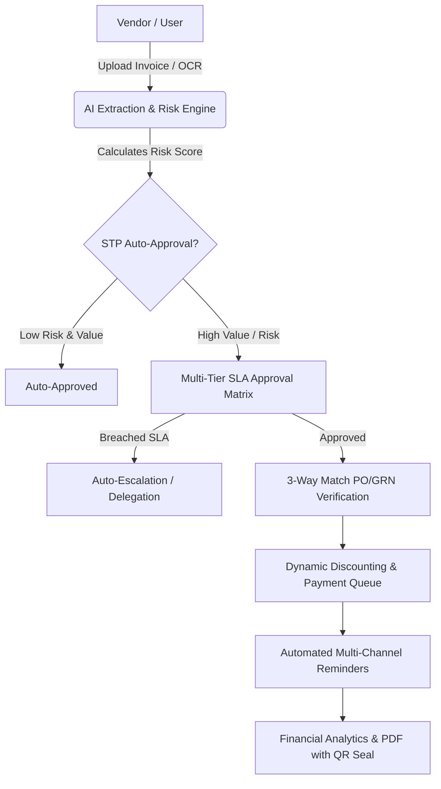

# Academic Major Project: SmartAudit AI — Intelligent Invoice Automation & Vendor Payment Suite

## 📌 Project Problem Statement & Core Baseline Use Case
> **User's Core Problem:** *"Businesses often experience delays in invoice approvals and vendor payments due to manual tracking. The platform should automate invoice verification, payment status tracking, reminders, and financial reporting."*

---

## 🌟 NEW INNOVATIVE FEATURES (Beyond the Baseline Use Case)

To elevate this project beyond a standard management portal into a **distinguished, high-scoring Major College Project**, we are adding the following 7 cutting-edge modules:

### 1. 🤖 AI Pre-Audit & Straight-Through Processing (STP) Auto-Approval
- **Problem Solved:** Finance managers waste days manually checking repetitive, low-value bills.
- **Innovation:**
  - AI engine scans the invoice, checks historical vendor rates, and calculates an **Anomaly/Fraud Risk Score (0-100%)**.
  - **Zero-Touch STP Auto-Approval**: Clean invoices below a configurable threshold (e.g. <₹10,000 with 0% risk score) are automatically verified and approved instantly without manual bottlenecks!

### 2. 🔄 Automated 3-Way Matching Engine (PO ⟷ GRN ⟷ Invoice)
- **Problem Solved:** Invoices get delayed because goods received in the warehouse don't match the purchase order or invoice amounts.
- **Innovation:**
  - Automated 3-Way reconciliation engine that cross-references Purchase Orders (PO), Goods Receipt Notes (GRN), and Invoices.
  - Highlights exact line-item discrepancies (quantity mismatch, rate inflation) with visual color diffs.

### 3. ⚡ FinTech Dynamic Discounting & Early Payment Calculator
- **Problem Solved:** Delays in payment hurt vendor relations and cause cash flow stagnation.
- **Innovation:**
  - Real-time sliding-scale dynamic discounting (e.g., *2% discount if paid within 10 days, 1% within 20 days*).
  - Shows instant annualized ROI savings for the buyer and early cash settlement for vendors.

### 4. ⏱️ SLA Auto-Escalation & Out-of-Office Delegation Engine
- **Problem Solved:** Approval queues stall indefinitely when a designated manager is absent or unresponsive.
- **Innovation:**
  - Visual countdown SLA timer per approval tier (e.g. 24-hour deadline).
  - If SLA breaches, the system automatically triggers hierarchical escalation or routes to a delegated secondary approver.

### 5. 📈 Predictive Cashflow Optimizer & Smart Payment Batcher
- **Problem Solved:** Companies struggle to decide which vendor invoices to prioritize when cash reserves fluctuate.
- **Innovation:**
  - Intelligent payment ranking algorithm sorting pending payouts by: due date urgency, discount loss penalty, vendor criticality score, and bank balance availability.

### 6. 🔏 Cryptographic QR Code Verification & Tamper-Evident PDF Generation
- **Problem Solved:** Paper and PDF invoices can be fabricated or manipulated after approval.
- **Innovation:**
  - Generates downloadable tax invoice PDFs embedded with a tamper-evident QR code containing an encrypted hash of the approval chain and timestamps.

### 7. 🎓 Built-in Academic Showcase & Viva Preparation Explorer
- **Problem Solved:** Preparing diagrams, reports, and viva answers for external college examiners.
- **Innovation:**
  - A dedicated in-app **"Project Viva Hub"** page rendering live interactive ER Diagrams, Architecture Flows, Sequence Diagrams, and an interactive Viva Q&A Trainer.

---

## 🏗️ Technical Architecture & Implementation Plan

### Files to Implement / Upgrade:

#### Backend:
1. **[NEW] `server/src/services/aiExtractionService.ts`**: AI OCR parser simulator with field extraction and confidence scores.
2. **[NEW] `server/src/services/fraudDetectionService.ts`**: Fraud, duplicate detection, and risk scoring engine.
3. **[NEW] `server/src/services/threeWayMatchService.ts`**: PO, GRN, and Invoice 3-way matching logic.
4. **[NEW] `server/src/services/dynamicDiscountService.ts`**: Early payment discount calculator.
5. **[NEW] `server/src/services/escalationService.ts`**: SLA breach monitor and auto-escalation handler.
6. **[MODIFY] `server/src/models/`**: Update `Invoice.ts`, `PurchaseOrder.ts`, `GRN.ts`, `Setting.ts`.
7. **[MODIFY] `server/src/controllers/`**: Integrate new endpoints for AI scan, 3-way match, dynamic discounting, and SLA management.
8. **[MODIFY] `server/src/scripts/seed.ts`**: Seed rich, realistic demo datasets including sample POs, GRNs, flagged fraud records, dynamic discount opportunities, and SLA cases.

#### Frontend:
1. **[NEW] `client/src/components/ai/AIInvoiceScanner.tsx`**: Interactive AI upload scanner modal with animated radar and extracted metadata preview.
2. **[NEW] `client/src/components/matching/ThreeWayMatchModal.tsx`**: 3-Way PO vs GRN vs Invoice interactive reconciliation visualizer.
3. **[NEW] `client/src/components/discounts/DynamicDiscountCalculator.tsx`**: Interactive slider calculating buyer savings & vendor payout dates.
4. **[NEW] `client/src/components/invoices/FraudRiskReportModal.tsx`**: Detailed risk factor breakdown modal.
5. **[NEW] `client/src/pages/ProjectDocsPage.tsx`**: Academic Viva Hub with live Mermaid ER diagrams, Architecture, and Viva Q&A cards.
6. **[MODIFY] `client/src/pages/DashboardPage.tsx` & `Navbar.tsx`**: Add quick-access widgets for SLA alerts, Risk Gauge, Dynamic Discounts, and Academic Hub link.

---

## 📋 Verification Plan
- **AI Scanning Test**: Upload a sample invoice -> observe real-time OCR extraction and risk calculation.
- **Auto-Approval / SLA Test**: Verify low-risk invoice straight-through approval and SLA timer countdown.
- **3-Way Match Test**: Cross-reference PO #PO-2026-001 with GRN and Invoice #INV-101.
- **Dynamic Discount Test**: Adjust payment date slider and verify automated discount deduction.
- **Academic Hub**: Verify all interactive diagrams, DFDs, and viva questions render seamlessly.
